# Flowise: IoT & Deep Learning Real-Time Water Leakage Detection System

[](https://www.python.org/)
[](https://pytorch.org/)
[](https://streamlit.io/)
[](https://flutter.dev/)
[](https://firebase.google.com/)
[](https://www.espressif.com/)
[](LICENSE)

**Flowise** is an end-to-end, enterprise-grade IoT and Deep Learning system designed to combat **Non-Revenue Water (NRW)** losses and pipeline infrastructure failures in modern **Water Distribution Systems (WDS)**. 

By unifying high-frequency dual-node edge sensors, scale-invariant hydraulic feature engineering, a **1D-CNN + GRU recurrent sequence network**, a zero-latency Firebase cloud telemetry bus, and a responsive cross-platform Flutter mobile dashboard, Flowise delivers autonomous, real-time leakage detection, false-positive suppression, and emergency valve actuation.

---

## Key Engineering Highlights

- **Dual-Node Differential Telemetry**: Simultaneous upstream and downstream pulse-flow (`YF-S201`) and hydrostatic pressure (`HK1100C`) acquisition running on an ESP32 edge node with hardware interrupt timers and 250-sample baseline oversampling.
- **Deep Temporal Sequence Modeling (1D-CNN + GRU)**: Replaced traditional tabular classifiers with a hybrid neural network (`FlowWiseHybridNet`) combining 1D convolutions for spatial/transient feature extraction and 2-layer Gated Recurrent Units (GRU) for temporal decay and wave dynamics.
- **Scale-Invariant & Dimensionless Feature Space**: Operates independently of pipe scale or absolute pump pressure by evaluating dimensionless divergence fractions and rolling 15-second historical trends.
- **Industrial-Grade Operational Safeguards**:
  - *Dynamic Operational Envelope Gating*: Running-median flow gate prevents false triggers during pump idle periods.
  - *Hydraulic Priming Protection*: 15-second startup grace period filters out transient water hammer and hydraulic shockwaves.
  - *Temporal Stabilization Buffer*: 4-out-of-6 confirmation sliding window eliminates intermittent sensor noise and bubbles.
  - *Autonomous Disconnect Fail-Safe*: Continuous heartbeat monitor pauses inference and alerts operators if ESP32 telemetry halts (>20s).
- **Automated Cloud Dispatch & FCM Alerts**: Cloud inference server synchronizes predicted states with Firebase RTDB and dispatches high-priority push notifications directly to Android devices via Firebase Cloud Messaging (FCM).
- **Cross-Platform Glassmorphic UI**: Role-based mobile client (Network Administrator vs. Consumer) featuring real-time telemetry streaming, historical analytics, biometric authentication, and remote valve shutoff.

---

## System Architecture

Flowise follows a distributed, modular 4-tier pipeline designed for high reliability and sub-second detection latency:

```
+-----------------------------------------------------------------------------------------+
|                                1. PHYSICAL HARDWARE LAYER                               |
|  [HK1100C Upstream]    [YF-S201 Upstream]     [YF-S201 Downstream]    [HK1100C Downstream] |
|            |                   |                       |                     |          |
|            +---------> [ESP32 Microcontroller Node (ISR + 250x ADC Avg)] <---+          |
|                                        |                                                |
|                             NTP-Synced SSL Telemetry                                    |
+----------------------------------------|------------------------------------------------+
                                         v
+-----------------------------------------------------------------------------------------+
|                               2. CLOUD TELEMETRY BRIDGE                                 |
|                         [Firebase Realtime Database (RTDB)]                             |
|               Paths: /sensor_readings  |  /user_tokens  |  /control_states               |
+----------------------------------------|------------------------------------------------+
                                         | 
                     Stream Sensor Telemetry (1 Hz Batch)
                                         v
+-----------------------------------------------------------------------------------------+
|                        3. DEEP LEARNING INFERENCE SERVICE                               |
|                     (Hugging Face Spaces / Streamlit Cloud)                             |
|                                                                                         |
|  [Raw Data Queue] ──> [Scale-Invariant Engine] ──> [1D-CNN + GRU Sequence Network]      |
|                                                              |                          |
|  [Auto-Hold & Heartbeat] <── [Temporal Stabilization (4/6)] <── [Sigmoid Logits (τ>0.55)]|
|                                        |                                                |
|                   Update Predicted Label & Dispatch FCM Alerts                          |
+----------------------------------------|------------------------------------------------+
                                         v
+-----------------------------------------------------------------------------------------+
|                               4. MOBILE CLIENT LAYER                                    |
|                             [Flutter Cross-Platform App]                                |
|    • Glassmorphic Status Dashboard         • Real-time fl_chart Telemetry Views          |
|    • Biometric Auth (local_auth)           • Push Notification Listener (FCM)           |
|    • Admin Remote Valve Actuation          • Consumer Usage Breakdown                    |
+-----------------------------------------------------------------------------------------+
```

---

## Deep Learning Inference Engine (`FlowWiseHybridNet`)

The production detection engine is hosted as a 24/7 background worker on **Hugging Face Spaces** (`hf_space/flowise-detector/app.py`), monitoring telemetry in real time.

### 1. Hybrid 1D-CNN + GRU Architecture
Standard machine learning models evaluate isolated samples, failing to capture time-dependent pressure waves and fluid momentum. Flowise utilizes a unified spatiotemporal network:

```
Input Sequence: (Batch, 15 Timesteps, 4 Features)
      │
      ▼
┌────────────────────────────────────────────────────────┐
│ 1D Convolutional Layer (Conv1D)                        │
│   • in_channels: 4, out_channels: 32, kernel: 3, pad: 1│ ──> Extracts local transient features
│   • Activation: ReLU                                   │     and sharp hydraulic divergence
└────────────────────────────────────────────────────────┘
      │
      ▼
┌────────────────────────────────────────────────────────┐
│ 2-Layer Gated Recurrent Unit (GRU)                     │
│   • input_size: 32, hidden_size: 64, num_layers: 2     │ ──> Models temporal sequence memory,
│   • batch_first: True                                  │     flow decay, and sustained losses
└────────────────────────────────────────────────────────┘
      │
      ▼ Last Timestep Latent Vector (Hidden: 64)
┌────────────────────────────────────────────────────────┐
│ Fully Connected Classification Head (Dense)            │
│   • Linear(64 -> 1) + Sigmoid Activation               │ ──> Calibrated Leak Probability [0.0, 1.0]
└────────────────────────────────────────────────────────┘
```

### 2. Dimensionless Scale-Invariant Feature Engine
To ensure model portability across varying pump capacities, pipe lengths, and line pressures, raw sensor inputs are projected into 4 dimensionless ratios:

$$\text{Flow Divergence Ratio} = \frac{F_1 - F_2}{F_1 + \epsilon}$$

$$\text{Flow Divergence Trend} = \text{RollingMean}_{15\text{s}}(\text{Flow Divergence Ratio})$$

$$\text{Pressure Drop Ratio} = \frac{P_1 - P_2}{P_1 + \epsilon}$$

$$\text{Pressure Drop Trend} = \text{RollingMean}_{15\text{s}}(\text{Pressure Drop Ratio})$$

### 3. Production Deployment Safeguards
| Mechanism | Configuration | Engineering Objective |
| :--- | :--- | :--- |
| **Operational Gating** | $F_1\text{ median}_{3\text{s}} > 0.15\text{ L/min}$ | Suppresses leak inference when pump is idle or shut off. |
| **Priming Core Window** | 15.0 seconds | Ignores transient hydraulic shock waves and water hammer during pump spin-up. |
| **Decision Threshold** | $P(\text{Leak}) \ge 0.55$ | Tuned threshold minimizing false alarms on noisy sensor readings. |
| **Temporal Queue** | 4 of 6 frames | Rolling confirmation buffer preventing single-spike false positives. |
| **Heartbeat Watchdog** | $\Delta t > 20.0\text{ seconds}$ | Flags `ESP32 Offline`, halts inference, and resets live metrics to prevent stale alerts. |

---

## Hardware Subsystem & Edge Computing

Flowise's physical prototype features a closed-loop Water Distribution System (WDS) pipe section instrumented with upstream and downstream sensor clusters.

### Full Prototype Setup
<p align="center">
  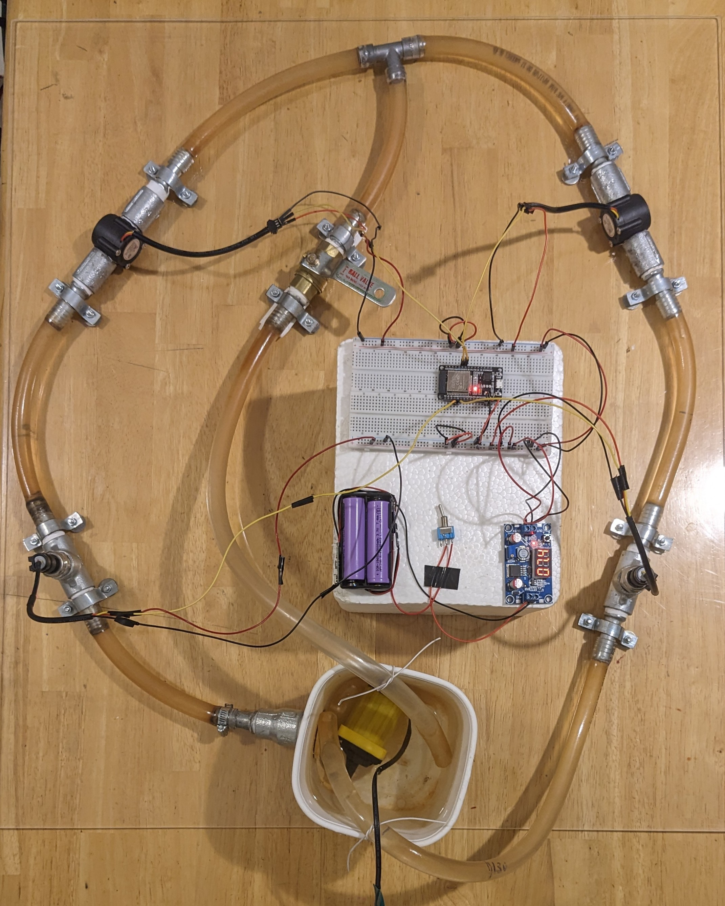
</p>

### Component Breakdown

| Component | Function & Specifications | Hardware Reference |
| :--- | :--- | :---: |
| **ESP32 Node** | Central dual-core 240 MHz MCU running FreeRTOS tasks, hardware timer ISRs, and WiFiClientSecure SSL connectivity. | 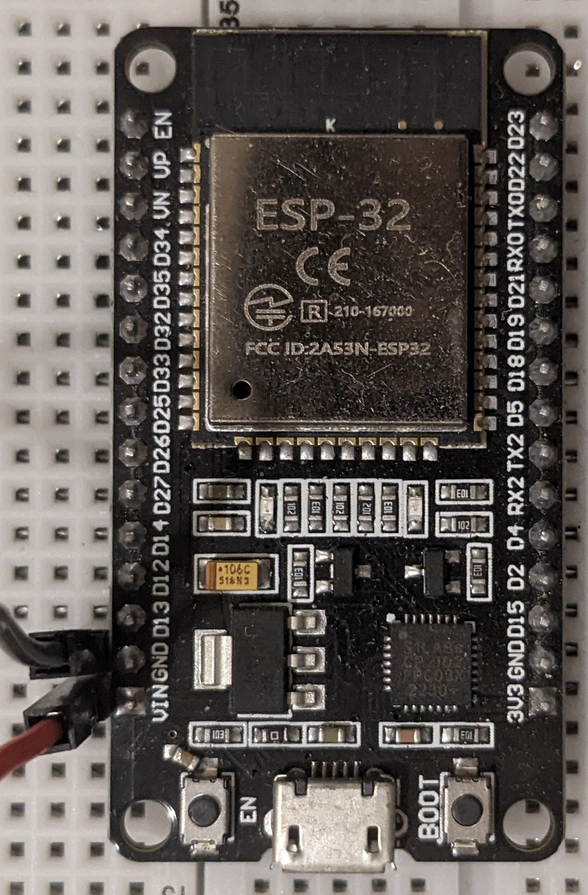 |
| **YF-S201 Flow Sensors** | Dual Hall-effect turbine sensors (Upstream $F_1$, Downstream $F_2$) capturing 1–30 L/min via interrupt pulse counting ($7.5\times Q$). | 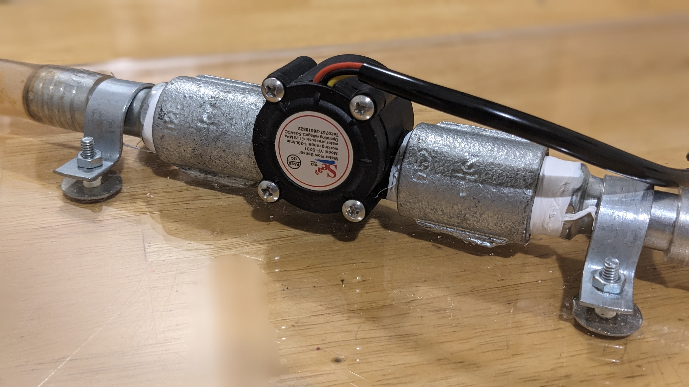 |
| **HK1100C Pressure Sensors** | Dual 0–1.2 MPa analog hydrostatic transducers ($P_1, P_2$) sampled with 250x averaging to eliminate electrical jitter. |  |
| **Solenoid Valve** | 12V DC in-line electromechanical valve enabling automated or remote emergency shutoff. | 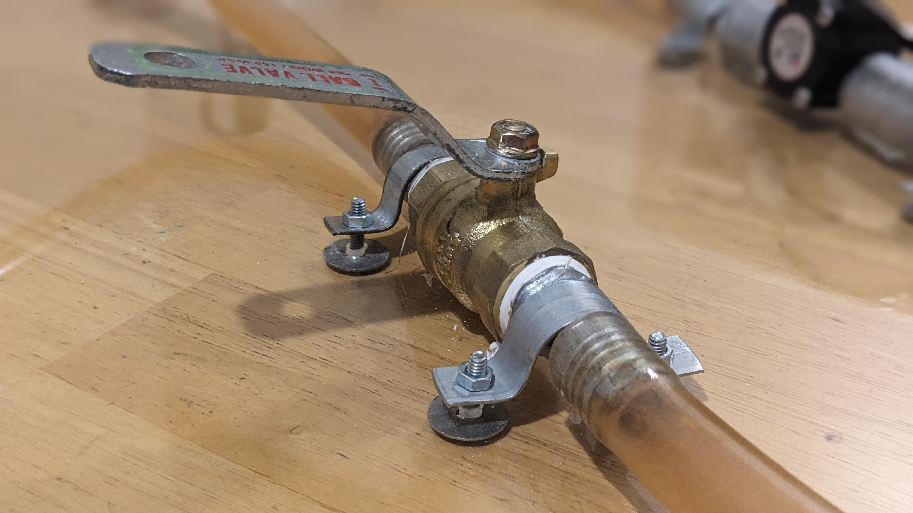 |
| **2S BMS & Power Supply** | 2S Li-ion battery protection board and dedicated DC supply ensuring uninterrupted operational power. | 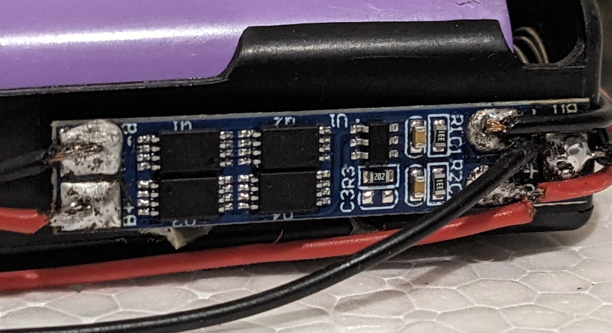<br>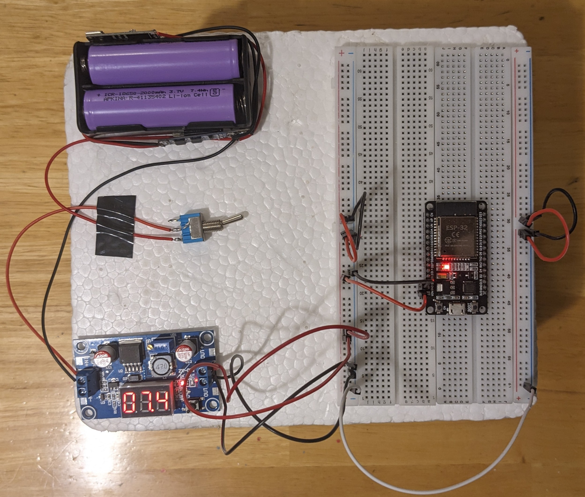 |
| **LM2596 Buck Converter** | High-efficiency step-down DC-DC switching regulator providing stabilized 5V/3.3V rails to the MCU and sensors. | 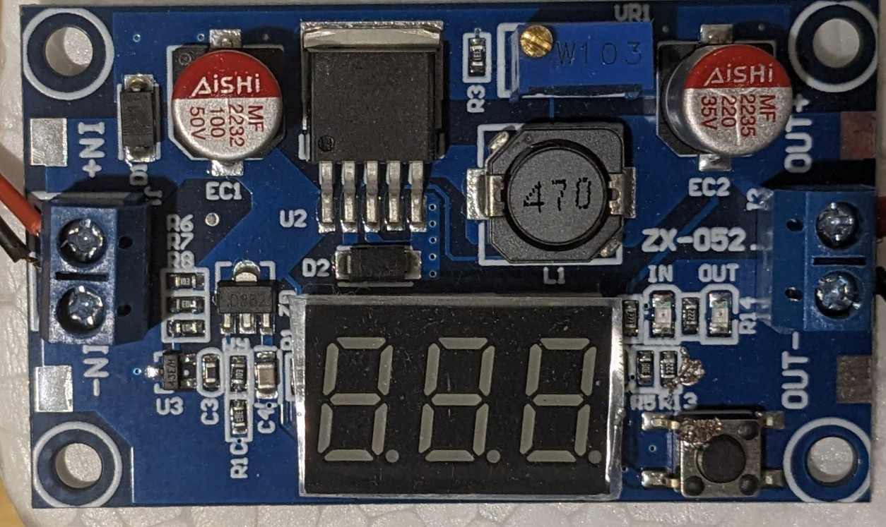 |
| **IP2326 Fast Charger** | Synchronous boost Li-ion battery charging module with Type-C input. | 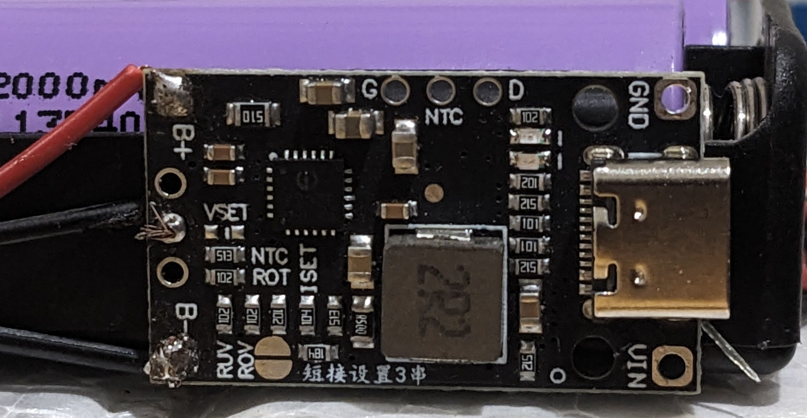 |

### Network Layout & Hydraulics
<p align="center">
  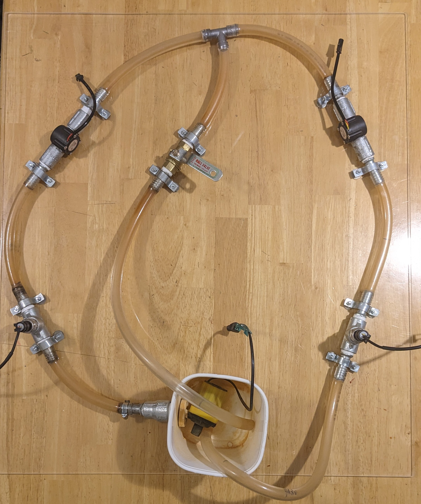
</p>

---

## Mobile Application (Flutter)

The Flowise mobile application delivers an intuitive glassmorphic interface with Role-Based Access Control (RBAC), biometric security, real-time telemetry streaming, and automated push notification routing.

### Screen Showcase

#### Onboarding & Authentication
| Multi-Role Selection | Secure Login & Biometric Auth |
| :---: | :---: |
| 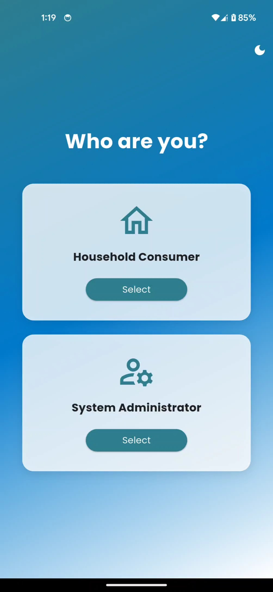 | 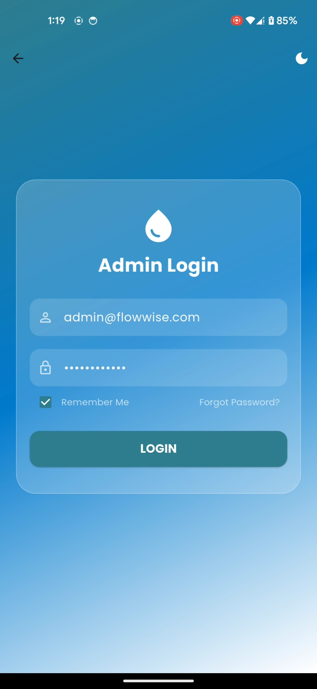 |

#### System Monitoring States
| Normal & Secure State | Inactive / Idle State | Active Telemetry Scanning |
| :---: | :---: | :---: |
| 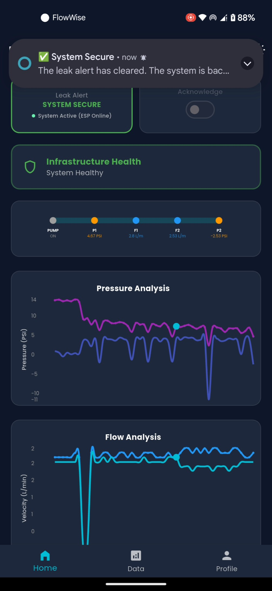 | 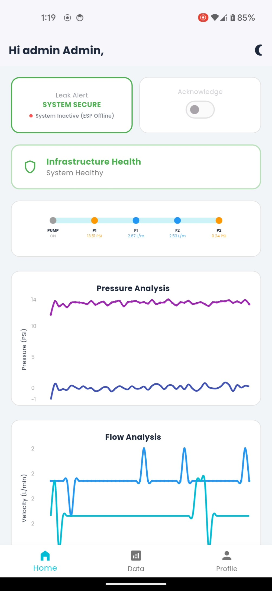 | 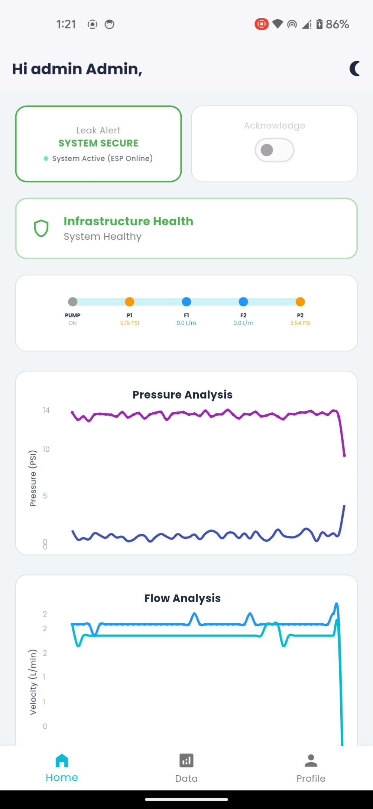 |

#### Alert Dispatch & Telemetry Logs
| Leak Detected Alert | Alert Acknowledged State | Telemetry History & Trends |
| :---: | :---: | :---: |
| 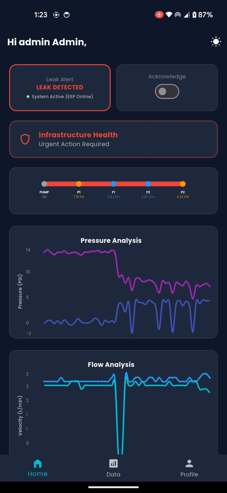 | 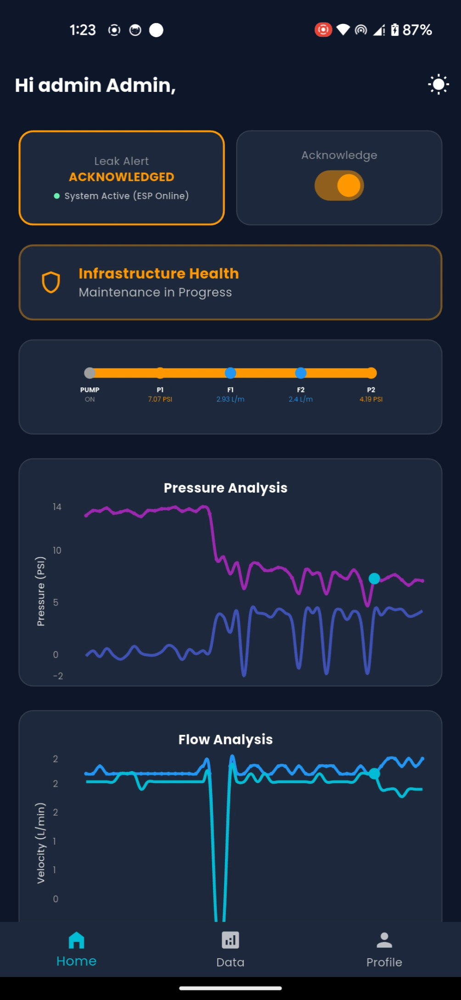 | 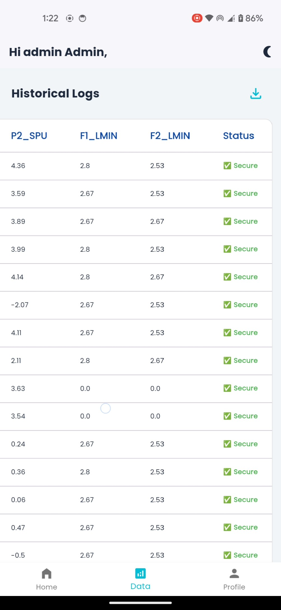 |

---

## Evaluation & Benchmarking

The system underwent rigorous evaluation across synthetic hydraulic simulations and real-world physical hardware scenarios (including micro-leaks, sudden bursts, valve throttling, and sensor drift).

| Metric | Synthetic Simulation Benchmark | Hardware Physical Testbed |
| :--- | :---: | :---: |
| **Accuracy** | 95.35% | **83.96%** |
| **Leak Detection Recall** | 95.26% | **90.99%** |
| **Precision** | 90.86% | **77.10%** |
| **F1-Score** | 93.00% | **83.47%** |
| **Detection Confirmation Window** | Instantaneous | **< 6.0 Seconds** (via 4/6 Voting) |

*Evaluation charts, confusion matrices, and scenario-specific performance plots are available in [`evaluation_results/`](evaluation_results/).*

---

## Repository Directory Structure

```plaintext
Flowise/
├── assets/images/              # Mobile application UI mockups and design assets
├── cloud_bridge/               # Legacy local Python bridge utilities
├── evaluation_results/         # Confusion matrices, ROC curves, and benchmark plots
├── hardware/
│   └── src/
│       └── sketch_apr20a/
│           ├── sketch_apr20a.ino # ESP32 production firmware (ISR, NTP, Firebase)
│           └── secrets.h.example # Template for network credentials & API keys
├── hardwaredev/                # High-resolution CAD/hardware setup photography
├── hf_space/
│   └── flowise-detector/       # 🚀 DEPLOYED 24/7 DEEP LEARNING CLOUD SERVICE
│       ├── app.py              # Streamlit monitor + 1D-CNN+GRU inference loop + FCM
│       ├── flowwise_inverted_sequence_net.pth # PyTorch trained model weights
│       ├── requirements.txt    # Cloud service dependencies
│       └── README.md           # Hugging Face Space configuration
├── ml_engine/                  # Jupyter notebooks for synthetic data generation & training
│   ├── datasetgen.ipynb        # Hydraulic physics-based synthetic dataset generator
│   └── hardwaretraining.ipynb  # Model training, validation, and export routines
└── mobile_app/                 # 📱 FLUTTER CROSS-PLATFORM CLIENT
    ├── lib/                    # Provider state management, screens, and services
    └── pubspec.yaml            # Flutter package dependencies
```

---

## Quickstart & Deployment Guide

### 1. ESP32 Edge Firmware Setup
1. Open [`hardware/src/sketch_apr20a/sketch_apr20a.ino`](hardware/src/sketch_apr20a/sketch_apr20a.ino) in the Arduino IDE.
2. Install required board packages (`esp32` by Espressif) and libraries (`FirebaseClient`, `FirebaseJson`).
3. Create a `secrets.h` file in the sketch folder:
   ```cpp
   #define WIFI_SSID "Your_WiFi_SSID"
   #define WIFI_PASSWORD "Your_WiFi_Password"
   #define DATABASE_URL "https://your-project-rtdb.firebaseio.com"
   #define Web_API_KEY "AIzaSy..."
   #define USER_EMAIL "device_node@flowise.internal"
   #define USER_PASS "secure_device_password"
   ```
4. Connect the ESP32 board, calibrate zero-flow baseline pressure, and flash the firmware.

### 2. Deep Learning Cloud Inference Service (Hugging Face / Local)
1. Navigate to the cloud detector directory:
   ```bash
   cd hf_space/flowise-detector
   pip install -r requirements.txt
   ```
2. Configure your Firebase credentials in `.streamlit/secrets.toml` or environment variables:
   ```toml
   DATABASE_URL = "https://your-project-rtdb.firebaseio.com"
   FIREBASE_SERVICE_ACCOUNT = '{"type": "service_account", "project_id": "...", ...}'
   ```
3. Run the live monitoring service locally:
   ```bash
   streamlit run app.py
   ```
   *(For continuous production monitoring, push this folder directly to a Hugging Face Streamlit Space).*

### 3. Flutter Mobile Application Setup
1. Navigate to the mobile client directory:
   ```bash
   cd mobile_app
   ```
2. Install package dependencies:
   ```bash
   flutter pub get
   ```
3. Attach an Android/iOS device or emulator and launch:
   ```bash
   flutter run
   ```

---

## License

This project is licensed under the **MIT License** — see the [LICENSE](LICENSE) file for full details.

---

## Contributors & Contact

- **Sara Khan** — Project Lead & Machine Learning / IoT Engineer
- For inquiries, collaborations, or demonstrations, feel free to reach out via GitHub or email.
